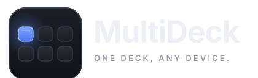
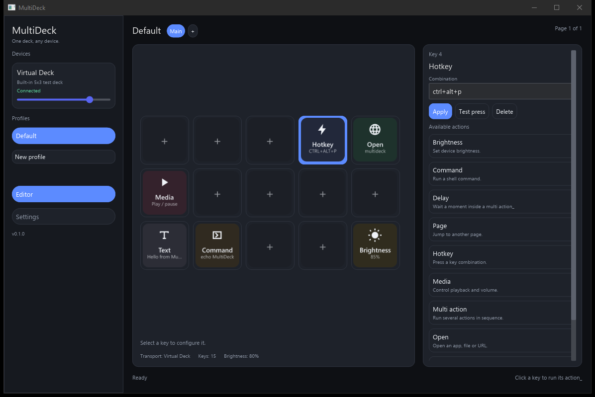
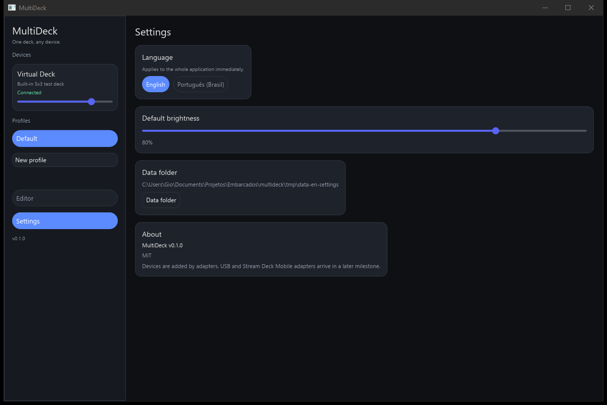
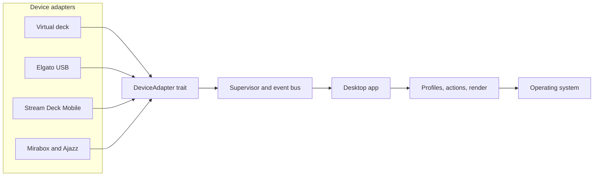

<p align="center">
  
</p>

<p align="center">
  <strong>One deck, any device.</strong><br>
  Stream deck software for Windows and Linux, built around a single device adapter layer.
</p>

<p align="center">
  <a href="https://github.com/callmeteus/multideck/actions/workflows/ci.yml"></a>
  <a href="LICENSE"></a>
  <a href="rust-toolchain.toml"></a>
  
</p>

MultiDeck hosts several kinds of stream deck behind one architecture: one profile format, one action set, and one adapter contract for every device. A virtual deck is built in, so layouts can be edited and actions tested without hardware.

## Features

- **Device adapters**: every deck implements the same `DeviceAdapter` trait and reports its own grid, encoders, touch strip and image format.
- **Virtual deck**: a 5x3 in process deck that follows the same command and input path as hardware.
- **USB decks**: Elgato Stream Deck detection, key images, encoders and touch through the same adapter contract.
- **Tray icon** on Windows: bring the window back or quit without hunting for the taskbar.
- **Profiles, pages and keys**: plain JSON profiles with multiple pages and per-profile brightness.
- **Ten native actions**: hotkey, open, text, media, command, delay, multi action, page jump, profile switch and brightness.
- **Auto-discovered actions**: actions register at compile time with `inventory`; there is no central list to edit.
- **Native rendering**: key images are composed with resvg and a system font, icons are rasterised from SVG, and the result is encoded to the format the device expects.
- **Two languages**: English and Brazilian Portuguese through Fluent, with system locale detection.

## Screenshots

<p align="center">
  
</p>

<p align="center"><em>Editor: pages, the 5x3 key grid and the action inspector.</em></p>

<p align="center">
  
</p>

<p align="center"><em>Settings: interface language, brightness and the data folder shortcut.</em></p>

## Supported devices

| Device | Transport | State |
| --- | --- | --- |
| Virtual deck | In process | Available |
| Elgato Stream Deck (USB) | USB HID | Implemented, awaiting hardware validation |
| Stream Deck Mobile | Network | Protocol mapped, adapter next |
| Mirabox and Ajazz | USB HID | Planned |

The [devices guide](docs/guide/devices.md) explains the contract and what each adapter still needs.

## Architecture



The adapter layer only translates images, commands and input. Profiles, actions and rendering live above it, which is why adding a device does not touch the editor, and adding an action does not touch device code.

The workspace is split into small crates: `core` (model), `store` (files), `render` (key images), `actions`, `platform` (OS side effects), `events` (bus and supervisor), `ui` (theme) and `devices/{api,virtual}`. See [docs/architecture.md](docs/architecture.md) for the dependency graph and the key press flow.

## Install

There are no prebuilt packages yet. Build from source with Rust 1.99 or newer.

### Windows

Install [Rust](https://rustup.rs) and the Visual Studio Build Tools with the C++ workload, then:

```powershell
git clone https://github.com/callmeteus/multideck.git
cd multideck
cargo run -p multideck-desktop
```

### Linux

Install a toolchain and the graphical development headers. On Debian or Ubuntu:

```sh
sudo apt install build-essential pkg-config libxkbcommon-dev libxkbcommon-x11-dev libwayland-dev libx11-dev
curl --proto '=https' --tlsv1.2 -sSf https://sh.rustup.rs | sh
git clone https://github.com/callmeteus/multideck.git
cd multideck
cargo run -p multideck-desktop
```

A release build uses thin LTO and strips symbols:

```sh
cargo build --release -p multideck-desktop
```

To produce a Windows installer with the icon set, Start menu entry and uninstaller:

```powershell
powershell -ExecutionPolicy Bypass -File scripts/build-installer.ps1
```

The result lands in `dist/`. Inno Setup 6 is required for that step only. Linux distribution packages are still on the roadmap.

The binary is `multideck`.

## Quickstart

1. Start the app. The editor opens with a default profile sized for the virtual deck.
2. Select a key, choose an action from the palette, fill its settings and press **Apply**.
3. Click a key to select it, then use **Test press** in the inspector. Hotkeys, opens, typed text and media keys go to the focused window.
4. Add pages with **New page**, and use the **Page** action to jump between them.
5. Switch the interface language in **Settings**; the choice is saved immediately.

State lives in `%APPDATA%\multideck` on Windows and `~/.config/multideck` on Linux. Set `MULTIDECK_DATA_DIR` to use another directory. Back up the folder to move a setup between machines.

## Documentation

The full documentation is a VitePress site in [`docs/`](docs/):

- [Getting started](docs/guide/getting-started.md)
- [Devices](docs/guide/devices.md)
- [Profiles and pages](docs/guide/profiles.md)
- [Actions](docs/guide/actions.md)
- [Language](docs/guide/language.md)
- [Architecture](docs/architecture.md)
- [Development](docs/development.md)
- [Roadmap](docs/roadmap.md)

Run it locally:

```sh
cd docs
pnpm install --no-frozen-lockfile
pnpm run dev
```

## Development

```sh
cargo test --workspace
cargo clippy --workspace --all-targets -- -D warnings
cargo fmt --all
```

Icons are generated from the brand mark with a dependency free script:

```sh
node assets/icons/build-icons.mjs
```

The workspace layout, the recipe for a new action, the checklist for a new adapter and the CI steps are in [docs/development.md](docs/development.md).

## Roadmap

- Validate the Elgato USB adapter on real MK.2, XL and Plus hardware, including replug.
- Add a visual multi action editor for the `multi` action.
- Write the Stream Deck Mobile adapter from the mapped VSD2 protocol, starting with one captured pairing session.
- Add the Mirabox and Ajazz adapter with a shared model table.
- Publish Windows and Linux packages.

Details and acceptance checks are in [docs/roadmap.md](docs/roadmap.md).

## Contributing

Issues and pull requests are welcome. For a large change, open an issue first so the scope is agreed before code is written.

- Keep the test suite green: `cargo test --workspace`.
- Fix every warning: the lint command treats warnings as errors.
- Add the translation keys for both languages when adding user visible text.
- Write documentation and commit messages in English.
- Keep changes focused: one action, one adapter or one documentation pass per pull request.

## License

MultiDeck is released under the MIT License. See [LICENSE](LICENSE).
