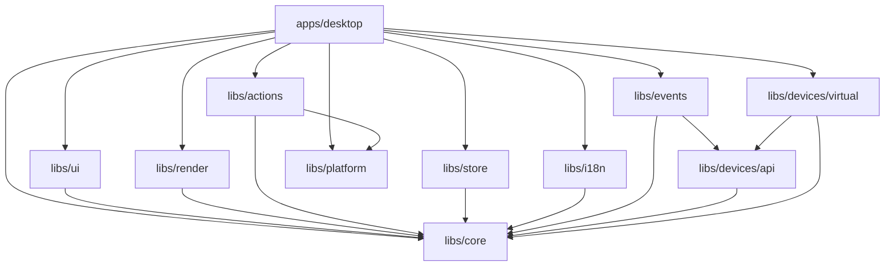
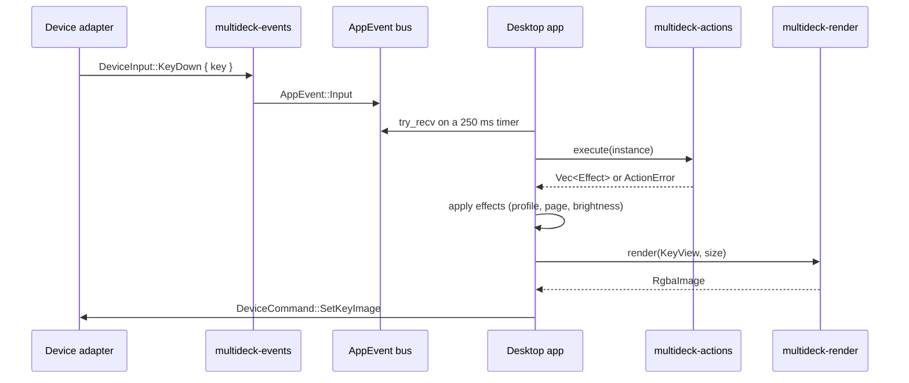

# Architecture

MultiDeck is a Cargo workspace with small crates. Each crate owns one concern, dependencies point in one direction, and hardware support is isolated behind a trait.

## Workspace map

```text
packages/
  apps/
    desktop/            multideck-desktop, the binary named multideck
    mobile/             reserved for a future mobile client
  libs/
    core/               profiles, actions metadata, device contract types
    events/             event bus and device supervisor
    render/             key image composition and encoding
    store/              settings and profile persistence
    i18n/               Fluent loader and locale selection
    actions/            action registry, executors and presentation
    platform/           operating system side effects
    ui/                 colors and widget styles
    devices/
      api/              the DeviceAdapter trait
      virtual/          the built-in virtual deck
    protocol/
      mobile/           reserved for the mobile protocol
  tools/
    probe/              device protocol experiments
```

## Dependencies



`core` depends on nothing from this workspace. `platform` is the only crate allowed to touch the user's desktop. `devices/api` depends on `core` and nothing else, which keeps adapters free of UI and action knowledge.

## Crates

| Crate | Responsibility |
| --- | --- |
| `multideck-core` | Serializable model: `Profile`, `Page`, `KeySlot`, `ActionInstance`, `DeviceCaps`, `DeviceDescriptor`, `DeviceCommand`, `DeviceInput`, `KeyView` |
| `multideck-events` | Broadcast bus (`AppEvent`), supervisor that owns an adapter task and forwards input |
| `multideck-store` | Data directory resolution, settings TOML, profile JSON, `ensure_profile` |
| `multideck-render` | Builds one SVG per key, rasterises icons with resvg, draws text with the system font, encodes to BMP, JPEG, PNG or raw RGBA |
| `multideck-i18n` | Compiles `locales/` at build time, detects the system locale, exposes `tr!` macros |
| `multideck-actions` | Registry of `ActionDef` plus executors, returns `Effect` values for host decisions |
| `multideck-platform` | Keystrokes, text, media keys, opening targets, shell commands, active window title |
| `multideck-ui` | Brand colors and reusable iced styles |
| `multideck-device-api` | `DeviceAdapter` trait, channel aliases, `DeviceError` |
| `multideck-device-virtual` | In process deck with shared key images and a press method for tests |
| `multideck-desktop` | Window, screens, editor, wiring, profile lifecycle |

## Key press flow



The UI polls the bus on a timer instead of owning a subscriber task. That keeps the iced update loop synchronous and makes the event order testable: a test can push a virtual key and read the bus. `KeyDown` events wait in a `VecDeque<u8>` so every press survives until its turn. If an action returns a delay, the queue stops and resumes from `EffectsReady` after the delay completes.

## Device adapter contract

An adapter implements two methods:

```rust
#[async_trait]
pub trait DeviceAdapter: Send + 'static {
    fn descriptor(&self) -> DeviceDescriptor;
    async fn run(
        self: Box<Self>,
        commands: CommandReceiver,
        inputs: InputSender,
    ) -> Result<(), DeviceError>;
}
```

`run` receives commands and reports inputs until one side closes. It must not block the async runtime: a blocking HID read belongs in a dedicated thread that forwards to the input sender.

Adding a device never changes the action set, the profile schema or the editor. The adapter translates between `RgbaImage` and the wire format of its hardware.

## Rendering

The renderer builds a square image per key:

1. Background and rounded frame from the key colors.
2. Icon path from `multideck-render/src/icons.rs`, wrapped in a small SVG and rasterised with resvg.
3. Title and optional subtitle drawn with the best system font found by fontdb.
4. Result cached by a key hash and image size, then returned as `Arc<RgbaImage>`.

Encoding happens at the edge, in `KeyRenderer::encode`, because the target format is a device property. Raw RGBA is used by the virtual deck, BMP and JPEG by Elgato generations, PNG is available for tooling.

## State

The desktop app holds one active profile and writes it on every change. Settings and profiles are written to a temporary file in the same directory and then replaced atomically, so a failed write keeps the previous complete file. Settings changes update memory only after the replacement succeeds. There is no in memory queue: pressing Apply writes the profile file and then asks every key to render. Startup does the reverse: open the store, load the active profile (or create `Default`), fit it to the device capabilities, render, then connect the adapter.

Settings and profiles are separate on purpose. Losing `settings.toml` costs the language choice and the active profile pointer, not the layouts.

## Error handling

Each crate has a typed error with `thiserror`:

| Error | Surfaces as |
| --- | --- |
| `CoreError` | Invalid profile, rejected at load |
| `StoreError` | I/O failure with the path and the attempted action |
| `ActionError` | Status line naming the action and the failing setting |
| `PlatformError` | Status line with the operating system reason |
| `DeviceError` | Disconnected device and a status message |
| `RenderError` | Logged per key, the previous image stays |

Errors carry the action kind or the device id so a log line is actionable without the UI state.

## Design decisions

**Adapters are dumb, actions are blind.** The adapter knows hardware, the action knows intent, and the host knows the layout. This is what allows the virtual deck to exercise the same path as a USB deck.

**Actions self register.** `inventory::submit!` collects every `RegisteredAction` at link time, and `definitions()` sorts them. There is no central match to update, so a plugin crate can add an action without editing the desktop app. The same resolver serves the palette, inspector and executor. Built-in actions take precedence over YAML plugins with the same kind.

**Files over a database.** Profiles are JSON and settings are TOML. Users can diff, generate and back up their layouts with tools they already have.

**No global mutable state.** The locale is the only process wide value, guarded by a `RwLock` because Fluent lookups happen while rendering. Everything else lives in the app struct.

Next: [development](/development) covers building, testing and extending the workspace.
